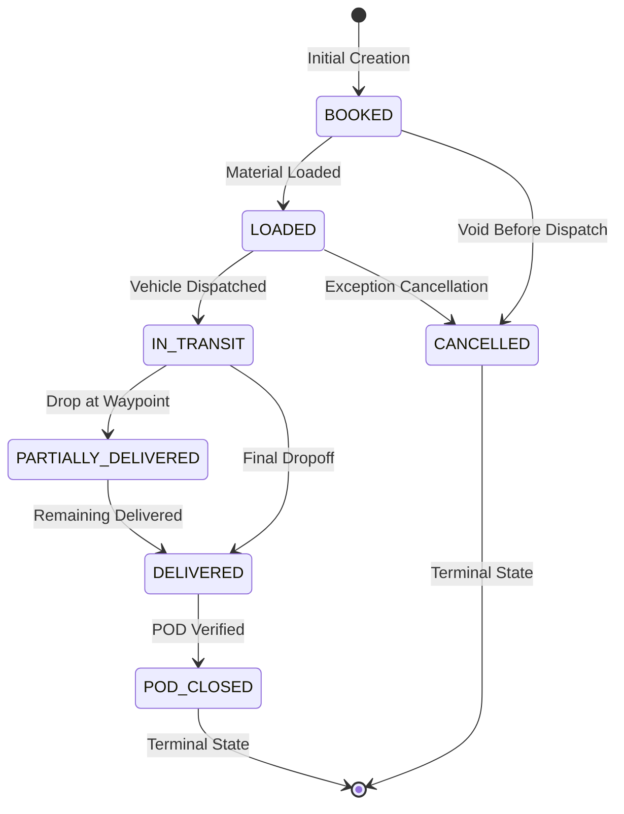

# Business Rules & Operational Logic Engine

**Platform:** MERN Fleet & Transport Management Platform  
**Scope:** Freight Formulas, Dispatch Pre-requisites, State Machine Transitions & Quantity Invariants  

---

## 1. Freight & Financial Calculation Engine

All calculations must be performed server-side using exact decimal arithmetic or integer Paise. Client-submitted balances are ignored.

### 1.1 Itemized Charge Components
1. **Base Freight ($F_{\text{base}}$):** Computed either as `Rate per MT * Weight MT` or flat fixed trip freight.
2. **Accessory Charges:**
   - Loading Charges ($C_{\text{loading}}$)
   - Unloading Charges ($C_{\text{unloading}}$)
   - Demurrage / Detention Charges ($C_{\text{detention}}$)
   - Toll & Bridge Taxes ($C_{\text{toll}}$)
   - Material Handling Charges ($C_{\text{handling}}$)
   - Miscellaneous / Incidental Charges ($C_{\text{misc}}$)
   - Additional Custom Lines ($\sum C_{\text{extra}}$)

### 1.2 Mathematical Formulas

$$\text{Taxable Freight} = F_{\text{base}} + C_{\text{loading}} + C_{\text{unloading}} + C_{\text{detention}} + C_{\text{toll}} + C_{\text{handling}} + C_{\text{misc}} + \sum C_{\text{extra}}$$

$$\text{GST Amount} = \text{Taxable Freight} \times \left(\frac{\text{GST Rate}}{100}\right)$$
*(Default GTA SAC `9965` rate: 5.0% without Input Tax Credit)*

$$\text{Gross Freight} = \text{Taxable Freight} + \text{GST Amount}$$

$$\text{Net Balance Payable} = \text{Gross Freight} - \text{Advance Paid} - \text{Total Deductions}$$

### 1.3 Rounding & Precision Rules
- Every component is calculated in integer Paise (`1 INR = 100 Paise`).
- Division and tax computations round to the nearest whole Paise using standard half-up rounding (`Math.round(taxablePaise * gstRate / 100)`).
- `Net Balance Payable` can never be negative under standard operations without auditing as a credit note.

---

## 2. State Machines & Status Transitions

State changes must follow strict forward paths. Arbitrary string updates are rejected.

### 2.1 LR Lifecycle State Machine

| Source State | Permitted Target States | Triggering Event / Action |
|---|---|---|
| `BOOKED` | `LOADED`, `CANCELLED` | Loading completed or booking voided |
| `LOADED` | `IN_TRANSIT`, `CANCELLED` | Trip gate-out dispatch |
| `IN_TRANSIT` | `PARTIALLY_DELIVERED`, `DELIVERED` | Waypoint arrival & offload |
| `PARTIALLY_DELIVERED` | `DELIVERED`, `CANCELLED` | Subsequent stop delivery |
| `DELIVERED` | `POD_CLOSED` | Received signoff & verified POD upload |
| `POD_CLOSED` | *None* | Immutable historical record |
| `CANCELLED` | *None* | Archived cancellation |

### 2.2 Trip Lifecycle State Machine
`CREATED` $\rightarrow$ `VEHICLE_ASSIGNED` $\rightarrow$ `LOADING` $\rightarrow$ `IN_TRANSIT` $\rightarrow$ `PARTIALLY_DELIVERED` $\rightarrow$ `DELIVERED` $\rightarrow$ `CLOSED` (or `CANCELLED`).

---

## 3. Dispatch Pre-requisites & Asset Conflict Prevention

Before any vehicle or driver is assigned to a trip or dispatched on a load, the `DispatchValidationService` validates the following invariant rules:

### 3.1 Vehicle Compliance Invariants
1. **Operational Status:** Vehicle `status` must be `AVAILABLE` or `ASSIGNED`. Any vehicle marked `UNDER_MAINTENANCE`, `INACTIVE`, or `OUT_OF_SERVICE` is rejected.
2. **Trip Conflict:** The vehicle cannot be currently bound to an active trip in status `LOADING`, `IN_TRANSIT`, or `PARTIALLY_DELIVERED`.
3. **Mandatory Documents:** The vehicle must possess active, verified documents:
   - Registration Certificate (`RC`)
   - Commercial Vehicle Insurance (`INSURANCE`)
   - Fitness Certificate (`FITNESS`)
   - Pollution Under Control (`PUC`)
4. **Expiry Date Check:** If any mandatory document's `expiryDate < currentDate`, dispatch is **hard-blocked** with error: `"Mandatory vehicle document [RC/INSURANCE/FITNESS] expired on YYYY-MM-DD. Dispatch forbidden."`

### 3.2 Driver Compliance Invariants
1. **Operational Status:** Driver `status` must be `AVAILABLE`. Drivers on `ON_TRIP`, `ON_LEAVE`, or `INACTIVE` cannot be assigned.
2. **Active Trip Conflict:** The driver cannot be currently assigned to an overlapping unfinished trip.
3. **Licence Verification:** Driver must hold an active `DRIVING_LICENCE` matching the vehicle category (e.g., `HMV` or `TRANS` for heavy goods vehicles).
4. **Licence Expiry:** If `licenseExpiryDate < currentDate`, dispatch is rejected.

---

## 4. Multi-Stop Waypoint & Quantity Invariants

1. **Sequential Stops:** Every load stop must have an ascending sequence integer (`1, 2, 3...`). Pickup stops must precede delivery stops for the corresponding material.
2. **Conservation of Quantity:**
   $$\sum \text{Delivered Quantity Across Stops} \le \text{Total Consigned Quantity}$$
3. **Over-Delivery Prevention:** Delivery of an excess quantity at any stop is disallowed unless an audited exception with a supervisor override reason is submitted.
4. **Stop Completion:** A stop is marked `COMPLETED` only when actual arrival time, departure time, and quantity offloaded are recorded.

---

## 5. Trip Closure & POD Verification Policy

A trip can transition to `CLOSED` status only when all of the following conditions are satisfied:
1. All associated load stops are marked `COMPLETED`.
2. All linked LR numbers have reached `DELIVERED` or `POD_CLOSED` status.
3. Every delivery stop has an attached, readable Proof of Delivery (`POD`) document (image or PDF) containing recipient acknowledgement.
4. All reported trip operational expenses (fuel, tolls) have recorded receipts or supervisor approval.
