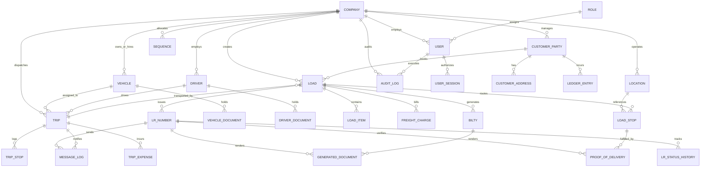

# Core Data Model & Entity Relationship Specification

**Platform:** MERN Fleet & Transport Management Platform  
**Storage Engine:** MongoDB (Mongoose Schema Models)  
**Monetary Representation Strategy:** Stored as integer Paise (`amount_in_paise = rupees * 100`) or explicit `Decimal128` to completely prevent floating-point precision loss.  
**Timestamps:** All dates stored as UTC `Date` objects. Display formatting handled via configured company timezone (default `Asia/Kolkata`).  

---

## 1. Entity Relationship Diagram (Mermaid)



---

## 2. Core Collections & Schema Definitions

### 2.1 Identity, Access & Audit

#### `companies` (Tenants / Organizations)
```typescript
{
  _id: ObjectId,
  legalName: { type: String, required: true },
  tradeName: { type: String, required: true },
  gstin: { type: String, required: true, uppercase: true },
  pan: { type: String, uppercase: true },
  email: { type: String, required: true },
  phone: { type: String, required: true },
  address: {
    street: String,
    city: String,
    state: String,
    pincode: String,
    country: { type: String, default: "IN" }
  },
  settings: {
    timezone: { type: String, default: "Asia/Kolkata" },
    currency: { type: String, default: "INR" },
    weightUnit: { type: String, enum: ["MT", "KG", "QUINTAL"], default: "MT" },
    distanceUnit: { type: String, enum: ["KM", "MILE"], default: "KM" },
    defaultGtaGstRate: { type: Number, default: 5.0 },
    defaultGtaSacCode: { type: String, default: "9965" }
  },
  branding: {
    logoUrl: String,
    letterheadHeaderUrl: String,
    authorizedSignatoryUrl: String
  },
  isActive: { type: Boolean, default: true },
  createdAt: Date,
  updatedAt: Date
}
// Indexes: { gstin: 1 }, { isActive: 1 }
```

#### `users`
```typescript
{
  _id: ObjectId,
  companyId: { type: ObjectId, ref: 'Company', required: true, index: true },
  name: { type: String, required: true },
  email: { type: String, required: true, lowercase: true },
  passwordHash: { type: String, required: true },
  phone: { type: String, required: true },
  roleId: { type: ObjectId, ref: 'Role', required: true },
  isActive: { type: Boolean, default: true },
  lastLoginAt: Date,
  createdAt: Date,
  updatedAt: Date
}
// Unique compound index: { companyId: 1, email: 1 }
```

#### `roles` & `permissions`
```typescript
// roles collection
{
  _id: ObjectId,
  companyId: { type: ObjectId, ref: 'Company', required: true, index: true },
  name: { type: String, required: true }, // e.g. "Transport Manager"
  slug: { type: String, required: true }, // e.g. "transport_manager"
  isSystemRole: { type: Boolean, default: false },
  permissions: [{
    module: { type: String, required: true }, // "loads", "vehicles", "billing", etc.
    actions: [{ type: String, enum: ["view", "add", "edit", "delete", "admin", "export"] }]
  }],
  createdAt: Date,
  updatedAt: Date
}
// Unique compound index: { companyId: 1, slug: 1 }
```

#### `user_sessions`
```typescript
{
  _id: ObjectId,
  userId: { type: ObjectId, ref: 'User', required: true, index: true },
  companyId: { type: ObjectId, ref: 'Company', required: true },
  refreshTokenHash: { type: String, required: true },
  ipAddress: String,
  userAgent: String,
  expiresAt: { type: Date, required: true, index: { expires: 0 } }, // TTL index
  isRevoked: { type: Boolean, default: false },
  createdAt: Date
}
```

#### `audit_logs` (Append-Only)
```typescript
{
  _id: ObjectId,
  companyId: { type: ObjectId, ref: 'Company', required: true, index: true },
  actorId: { type: ObjectId, ref: 'User', index: true },
  module: { type: String, required: true }, // "AUTH", "LOADS", "LR", "TRIPS", "BILLING"
  action: { type: String, required: true }, // "CREATE", "STATUS_CHANGE", "FINANCIAL_UPDATE"
  entityId: { type: Schema.Types.Mixed },
  oldValues: Schema.Types.Mixed,
  newValues: Schema.Types.Mixed,
  ipAddress: String,
  userAgent: String,
  createdAt: { type: Date, default: Date.now, index: true }
}
// Compound index: { companyId: 1, module: 1, createdAt: -1 }
```

---

### 2.2 Master Data: Customers, Locations, Vehicles & Drivers

#### `customer_parties`
```typescript
{
  _id: ObjectId,
  companyId: { type: ObjectId, ref: 'Company', required: true, index: true },
  name: { type: String, required: true },
  code: { type: String, uppercase: true }, // Customer business code
  partyType: { type: String, enum: ["CUSTOMER", "CONSIGNOR", "CONSIGNEE", "TRANSPORTER", "BOTH"], default: "CUSTOMER" },
  gstin: { type: String, uppercase: true },
  pan: { type: String, uppercase: true },
  primaryContact: {
    name: String,
    phone: String,
    email: String,
    designation: String
  },
  billingAddress: {
    street: String,
    city: String,
    state: String,
    stateCode: String,
    pincode: String
  },
  deliveryAddresses: [{
    label: String,
    street: String,
    city: String,
    state: String,
    pincode: String,
    contactPerson: String,
    contactPhone: String
  }],
  paymentTermsDays: { type: Number, default: 30 },
  creditLimitPaise: { type: Number, default: 0 },
  isActive: { type: Boolean, default: true },
  createdAt: Date,
  updatedAt: Date
}
// Compound index: { companyId: 1, name: 1 }, { companyId: 1, gstin: 1 }
```

#### `locations`
```typescript
{
  _id: ObjectId,
  companyId: { type: ObjectId, ref: 'Company', required: true, index: true },
  name: { type: String, required: true }, // e.g. "Ahmedabad Hub", "Sanand Factory Gate 2"
  locationType: { type: String, enum: ["HUB", "PICKUP", "DELIVERY", "WAYPOINT"], default: "PICKUP" },
  address: {
    street: String,
    city: { type: String, required: true },
    state: { type: String, required: true },
    pincode: String
  },
  coordinates: {
    lat: Number,
    lng: Number
  },
  contactPerson: String,
  contactPhone: String,
  customerId: { type: ObjectId, ref: 'CustomerParty' }, // optional mapping to specific customer
  isActive: { type: Boolean, default: true },
  createdAt: Date,
  updatedAt: Date
}
// Compound index: { companyId: 1, name: 1 }
```

#### `vehicles`
```typescript
{
  _id: ObjectId,
  companyId: { type: ObjectId, ref: 'Company', required: true, index: true },
  plateNumber: { type: String, required: true, uppercase: true }, // e.g. "GJ01AB1234"
  vehicleType: { type: String, required: true }, // "Trailer", "Open Truck", "Container", "Tempo"
  category: { type: String, enum: ["OWNED", "ATTACHED", "MARKET"], default: "OWNED" },
  make: String,
  model: String,
  yearOfManufacture: Number,
  capacityTonnage: { type: Number, required: true },
  chassisNumber: String,
  engineNumber: String,
  ownerName: String,
  ownerPhone: String,
  status: {
    type: String,
    enum: ["AVAILABLE", "ASSIGNED", "ON_TRIP", "UNDER_MAINTENANCE", "INACTIVE", "OUT_OF_SERVICE"],
    default: "AVAILABLE",
    index: true
  },
  currentTripId: { type: ObjectId, ref: 'Trip' },
  isActive: { type: Boolean, default: true },
  createdAt: Date,
  updatedAt: Date
}
// Unique compound index: { companyId: 1, plateNumber: 1 }
```

#### `vehicle_documents`
```typescript
{
  _id: ObjectId,
  companyId: { type: ObjectId, ref: 'Company', required: true, index: true },
  vehicleId: { type: ObjectId, ref: 'Vehicle', required: true, index: true },
  documentType: {
    type: String,
    enum: ["RC", "INSURANCE", "PUC", "FITNESS", "NATIONAL_PERMIT", "STATE_PERMIT", "TAX_RECEIPT", "OTHER"],
    required: true
  },
  documentNumber: String,
  issueDate: Date,
  expiryDate: { type: Date, required: true, index: true },
  fileKey: { type: String, required: true }, // Storage path
  originalFileName: String,
  mimeType: String,
  fileSize: Number,
  complianceStatus: {
    type: String,
    enum: ["VALID", "EXPIRING_SOON", "EXPIRED"],
    default: "VALID"
  },
  isActive: { type: Boolean, default: true },
  createdAt: Date,
  updatedAt: Date
}
```

#### `drivers`
```typescript
{
  _id: ObjectId,
  companyId: { type: ObjectId, ref: 'Company', required: true, index: true },
  name: { type: String, required: true },
  phone: { type: String, required: true },
  alternatePhone: String,
  licenseNumber: { type: String, required: true, uppercase: true },
  licenseType: { type: String, enum: ["LMV", "HMV", "TRANS", "TRAILER"], default: "HMV" },
  licenseExpiryDate: { type: Date, required: true, index: true },
  address: String,
  emergencyContact: {
    name: String,
    relation: String,
    phone: String
  },
  status: {
    type: String,
    enum: ["AVAILABLE", "ASSIGNED", "ON_TRIP", "ON_LEAVE", "INACTIVE"],
    default: "AVAILABLE",
    index: true
  },
  currentVehicleId: { type: ObjectId, ref: 'Vehicle' },
  currentTripId: { type: ObjectId, ref: 'Trip' },
  isActive: { type: Boolean, default: true },
  createdAt: Date,
  updatedAt: Date
}
// Unique compound index: { companyId: 1, licenseNumber: 1 }
```

---

### 2.3 Operations: Loads, LR Numbers, Multi-Stop & Bilties

#### `loads`
```typescript
{
  _id: ObjectId,
  companyId: { type: ObjectId, ref: 'Company', required: true, index: true },
  loadNumber: { type: String, required: true }, // e.g. "LD-2026-00101"
  customerId: { type: ObjectId, ref: 'CustomerParty', required: true, index: true },
  consignorId: { type: ObjectId, ref: 'CustomerParty', required: true },
  consigneeId: { type: ObjectId, ref: 'CustomerParty', required: true },
  orderDate: { type: Date, default: Date.now },
  expectedDeliveryDate: Date,
  status: {
    type: String,
    enum: ["CREATED", "ASSIGNED", "LOADING", "IN_TRANSIT", "PARTIALLY_DELIVERED", "DELIVERED", "CLOSED", "CANCELLED"],
    default: "CREATED",
    index: true
  },
  totalWeightMt: { type: Number, required: true },
  totalQuantity: Number,
  packageType: String, // e.g. "Bags", "Drums", "Boxes", "Loose"
  assignedVehicleId: { type: ObjectId, ref: 'Vehicle' },
  assignedDriverId: { type: ObjectId, ref: 'Driver' },
  currentTripId: { type: ObjectId, ref: 'Trip' },
  financials: {
    baseFreightPaise: { type: Number, required: true },
    loadingPaise: { type: Number, default: 0 },
    unloadingPaise: { type: Number, default: 0 },
    detentionPaise: { type: Number, default: 0 },
    tollPaise: { type: Number, default: 0 },
    handlingPaise: { type: Number, default: 0 },
    miscPaise: { type: Number, default: 0 },
    taxableFreightPaise: { type: Number, required: true },
    gstRatePercent: { type: Number, default: 5.0 },
    gstAmountPaise: { type: Number, default: 0 },
    grossFreightPaise: { type: Number, required: true },
    advancePaidPaise: { type: Number, default: 0 },
    deductionsPaise: { type: Number, default: 0 },
    balancePayablePaise: { type: Number, required: true }
  },
  remarks: String,
  createdAt: Date,
  updatedAt: Date
}
// Unique compound index: { companyId: 1, loadNumber: 1 }
```

#### `load_stops` (Ordered Waypoints)
```typescript
{
  _id: ObjectId,
  companyId: { type: ObjectId, ref: 'Company', required: true },
  loadId: { type: ObjectId, ref: 'Load', required: true, index: true },
  sequence: { type: Number, required: true }, // 1, 2, 3...
  stopType: { type: String, enum: ["PICKUP", "DELIVERY"], required: true },
  locationId: { type: ObjectId, ref: 'Location', required: true },
  contactPerson: String,
  contactPhone: String,
  scheduledTime: Date,
  actualArrivalTime: Date,
  actualDepartureTime: Date,
  status: {
    type: String,
    enum: ["PENDING", "ARRIVED", "LOADING", "UNLOADING", "COMPLETED", "FAILED"],
    default: "PENDING"
  },
  allocatedQuantity: Number,
  deliveredQuantity: { type: Number, default: 0 },
  pendingQuantity: { type: Number, default: 0 },
  remarks: String,
  createdAt: Date,
  updatedAt: Date
}
// Compound index: { loadId: 1, sequence: 1 }
```

#### `lr_numbers` (Lorry Receipts)
```typescript
{
  _id: ObjectId,
  companyId: { type: ObjectId, ref: 'Company', required: true, index: true },
  lrNumber: { type: String, required: true }, // e.g. "LR-2026-00452"
  isManualNumber: { type: Boolean, default: false },
  loadId: { type: ObjectId, ref: 'Load', required: true, index: true },
  vehicleId: { type: ObjectId, ref: 'Vehicle', required: true },
  driverId: { type: ObjectId, ref: 'Driver', required: true },
  status: {
    type: String,
    enum: ["BOOKED", "LOADED", "IN_TRANSIT", "PARTIALLY_DELIVERED", "DELIVERED", "POD_CLOSED", "CANCELLED"],
    default: "BOOKED",
    index: true
  },
  issuedDate: { type: Date, default: Date.now },
  deliveryDate: Date,
  eWayBillNumber: String,
  eWayBillExpiry: Date,
  pdfFileKey: String,
  createdAt: Date,
  updatedAt: Date
}
// Unique compound index: { companyId: 1, lrNumber: 1 }
```

#### `bilties` (Consignment Notes)
```typescript
{
  _id: ObjectId,
  companyId: { type: ObjectId, ref: 'Company', required: true, index: true },
  biltyNumber: { type: String, required: true }, // e.g. "BL-2026-00452"
  lrId: { type: ObjectId, ref: 'LrNumber', required: true, index: true },
  loadId: { type: ObjectId, ref: 'Load', required: true },
  consignorId: { type: ObjectId, ref: 'CustomerParty', required: true },
  consigneeId: { type: ObjectId, ref: 'CustomerParty', required: true },
  fromLocationId: { type: ObjectId, ref: 'Location', required: true },
  toLocationId: { type: ObjectId, ref: 'Location', required: true },
  paymentTerms: { type: String, enum: ["TO_PAY", "PAID", "TO_BE_BILLED"], default: "TO_PAY" },
  totalFreightPaise: { type: Number, required: true },
  advancePaise: { type: Number, default: 0 },
  balancePaise: { type: Number, required: true },
  pdfFileKey: String,
  status: { type: String, enum: ["DRAFT", "ISSUED", "CANCELLED"], default: "ISSUED" },
  createdAt: Date,
  updatedAt: Date
}
// Unique compound index: { companyId: 1, biltyNumber: 1 }
```

---

### 2.4 Trips, Proof of Delivery (POD) & Messages

#### `trips`
```typescript
{
  _id: ObjectId,
  companyId: { type: ObjectId, ref: 'Company', required: true, index: true },
  tripNumber: { type: String, required: true }, // e.g. "TR-2026-00089"
  vehicleId: { type: ObjectId, ref: 'Vehicle', required: true, index: true },
  driverId: { type: ObjectId, ref: 'Driver', required: true, index: true },
  loadIds: [{ type: ObjectId, ref: 'Load' }],
  startOdometer: Number,
  endOdometer: Number,
  startDateTime: Date,
  expectedDeliveryDateTime: Date,
  actualEndDateTime: Date,
  status: {
    type: String,
    enum: ["CREATED", "VEHICLE_ASSIGNED", "LOADING", "IN_TRANSIT", "PARTIALLY_DELIVERED", "DELIVERED", "CLOSED", "CANCELLED"],
    default: "CREATED",
    index: true
  },
  expenses: [{
    category: { type: String, enum: ["FUEL", "TOLL", "MAINTENANCE", "DRIVER_ALLOWANCE", "POLICE_MISC", "OTHER"] },
    amountPaise: Number,
    receiptFileKey: String,
    notes: String,
    date: Date
  }],
  totalExpensePaise: { type: Number, default: 0 },
  remarks: String,
  createdAt: Date,
  updatedAt: Date
}
// Unique compound index: { companyId: 1, tripNumber: 1 }
```

#### `proof_of_deliveries` (POD)
```typescript
{
  _id: ObjectId,
  companyId: { type: ObjectId, ref: 'Company', required: true, index: true },
  lrId: { type: ObjectId, ref: 'LrNumber', required: true, index: true },
  loadId: { type: ObjectId, ref: 'Load', required: true },
  stopId: { type: ObjectId, ref: 'LoadStop', required: true },
  deliveredQuantity: { type: Number, required: true },
  receivedByName: { type: String, required: true },
  receivedByPhone: String,
  deliveredAt: { type: Date, required: true },
  attachmentFileKey: { type: String, required: true },
  attachmentMimeType: String,
  notes: String,
  status: { type: String, enum: ["SUBMITTED", "VERIFIED", "REJECTED"], default: "SUBMITTED" },
  verifiedById: { type: ObjectId, ref: 'User' },
  verifiedAt: Date,
  createdAt: Date,
  updatedAt: Date
}
```

#### `message_logs` (WhatsApp / Communication Trail)
```typescript
{
  _id: ObjectId,
  companyId: { type: ObjectId, ref: 'Company', required: true, index: true },
  provider: { type: String, enum: ["MOCK", "INTERAKT", "TWILIO"], required: true },
  recipientPhone: { type: String, required: true },
  templateName: String,
  messageType: { type: String, enum: ["TEMPLATE", "PDF", "CUSTOM_TEXT"] },
  payload: Schema.Types.Mixed,
  providerMessageId: String,
  status: { type: String, enum: ["QUEUED", "DISPATCHED", "DELIVERED", "FAILED", "MOCK_DELIVERED"], default: "QUEUED" },
  errorMessage: String,
  relatedEntity: {
    entityType: { type: String, enum: ["LOAD", "LR", "BILTY", "TRIP", "POD"] },
    entityId: ObjectId
  },
  retryCount: { type: Number, default: 0 },
  sentAt: Date,
  createdAt: Date,
  updatedAt: Date
}
```

#### `contact_submissions` (Public Website Contact Form)
```typescript
{
  _id: ObjectId,
  name: { type: String, required: true },
  email: { type: String, required: true },
  phone: { type: String, required: true },
  company: String,
  fleetSize: String,
  message: { type: String, required: true },
  ipAddress: String,
  status: { type: String, enum: ["NEW", "CONTACTED", "ARCHIVED"], default: "NEW" },
  createdAt: { type: Date, default: Date.now }
}
```
