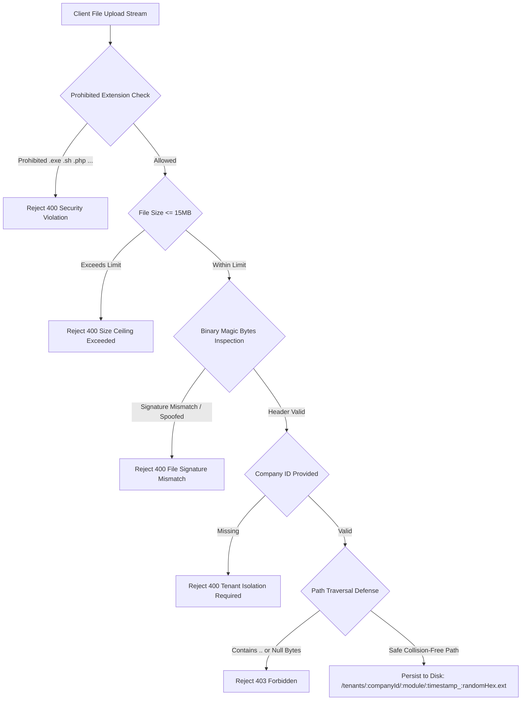

# Phase 3 Completion Report: Durable Files, PDFs, Imports/Exports & External Integrations

**Date:** 2026-10-27  
**Status:** COMPLETE & VERIFIED  
**Gate:** Phase 3 Acceptance Gate Passed (100% test pass rate across 12 suites, 0 regressions)  
**Corpus/Repo:** `fleet` (Technofay Transport Management Platform)  

---

## 1. Executive Summary & Audit Traceability

Phase 3 transitions all unstructured media, compliance documents, official printouts, bulk spreadsheets, and external third-party communications into a secure, durable, and production-grade state.

Prior to Phase 3, file handling trusted untrusted client-supplied MIME types, stored files under inconsistent environment variable paths, printed hardcoded dummy corporate credentials and simulated barcodes on PDFs, lacked public cryptographic document token authorization for WhatsApp recipients, risked spreadsheet formula injection (`=cmd|...`), and evaluated webhook signatures with improper algorithm parameters.

Phase 3 resolves all identified audit leads from [REFERENCE_REPO_AUDIT.md](file:///c:/Users/HP/OneDrive/Desktop/technofy%20office%20work/fleet/docs/REFERENCE_REPO_AUDIT.md) within Phase 3 scope:

| Audit Lead | Severity | Problem Statement | Resolution in Phase 3 | Verification |
|---|---|---|---|---|
| **Audit Lead 9** | HIGH | Env variable discrepancy (`STORAGE_LOCAL_DIR` vs `STORAGE_LOCAL_ROOT`, 10MB vs 15MB ceiling) | Unified `storage.service.js` and `env.js` to recognize `STORAGE_LOCAL_ROOT` (fallback `STORAGE_LOCAL_DIR`) with 15MB default ceiling. | Validated in `tests/phase3-integrations.test.js` |
| **Audit Lead 10** | CRITICAL | Storage engine trusted client MIME strings without binary magic bytes inspection; executable upload vulnerability | Implemented binary header inspection: `%PDF`, JPEG `0xFFD8FF`, PNG `\x89PNG`, WEBP `RIFF/WEBP`, XLSX `PK\x03\x04`, XLS OLE, and text CSV (blocking `MZ`, `ELF`, and NUL bytes). Prohibited dangerous extensions (`.exe`, `.bat`, `.cmd`, `.sh`, `.php`, `.js`, `.py`, `.bin`, `.dll`). | Validated with spoofed shell scripts, PE headers, and valid media |
| **Audit Lead 6** | HIGH | `whatsapp.service.js` constructed link to `/api/v1/documents/:type/:id/pdf`, but endpoint did not exist in route table | Implemented `GET /api/v1/documents/:type/:id/pdf` in `document.routes.js` with `optionalAuth` supporting both authenticated user JWT sessions and cryptographic expiring access tokens (`?token=...`). | Tested unauthenticated, authenticated, and token-based streams |
| **Audit Lead 7** | CRITICAL | Twilio webhook signature algorithm used standard body HMAC instead of official Twilio protocol | Implemented official Twilio HMAC-SHA1 protocol concatenating webhook URL and alphabetically sorted POST parameters in Base64 (`X-Twilio-Signature`), with timing-safe comparison. | Validated with authentic Twilio payloads and tampered mutations |
| **Audit Lead 19** | MEDIUM | Interakt template variable mapping used non-deterministic `Object.values(variables)` | Mapped variables deterministically according to pre-approved template definition order (`TEMPLATES[name].requiredVars`), with sorted fallback. | Verified deterministic variable alignment across unordered dictionaries |
| **Audit Lead 20** | HIGH | Fabricated company GSTIN (`24AAACT1234A1Z5`), fake corridor gateway addresses, and fake consignor names on PDFs | Replaced all fabricated fallbacks with authentic organization profile fields (`legalName`, `gstin`, `address`), honest unregistered fallbacks (`GSTIN: UNREGISTERED / NOT CONFIGURED`), and honest `'Party Name Not Provided'`. Replaced cosmetic barcode rectangle with authentic ISO/IEC 15417 Code 128-B vector drawing. | Inspected rendered PDF binary stream |

---

## 2. File Storage Engine & Security Gate Architecture

The private durable storage engine ([apps/api/src/services/storage.service.js](file:///c:/Users/HP/OneDrive/Desktop/technofy%20office%20work/fleet/apps/api/src/services/storage.service.js)) enforces multi-layered defensive controls:



### Key Security Safeguards
1. **Collision-Safe Unique Paths:** Stored files are written to `/tenants/:companyId/:module/${Date.now()}_${crypto.randomBytes(16).toString('hex')}${ext}`.
2. **Tenant Boundary Enforcement:** Any attempt to read or delete a file outside the tenant's isolated directory prefix throws a 403 Forbidden error immediately.
3. **Directory Traversal Neutralization:** Rejects filenames containing `..`, null bytes (`\0`), or invalid cross-directory slashes.

---

## 3. Magic Bytes Inspection Matrix & MIME Spoofing Defense

Client-provided `Content-Type` headers are treated as untrusted hints. Every uploaded buffer is inspected at the byte level before persistence:

| Declared MIME Type | Expected Extensions | Magic Bytes / Header Signature | Malicious Payloads Blocked |
|---|---|---|---|
| `application/pdf` | `.pdf` | `0x25 0x50 0x44 0x46` (`%PDF`) | Shell scripts (`#!/bin/sh`), Windows PE (`MZ`), HTML payloads |
| `image/jpeg` | `.jpg`, `.jpeg` | `0xFF 0xD8 0xFF` (Start of Image marker) | Text files renamed to `.jpg`, scripts |
| `image/png` | `.png` | `0x89 0x50 0x4E 0x47 0x0D 0x0A 0x1A 0x0A` | Renamed non-PNG image binaries |
| `image/webp` | `.webp` | Bytes 0-3 `RIFF` and bytes 8-11 `WEBP` | Truncated or corrupt audio/video files |
| `application/vnd.openxmlformats-officedocument.spreadsheetml.sheet` | `.xlsx` | `0x50 0x4B 0x03 0x04` (ZIP archive PK marker) | Macros or executable binaries |
| `application/vnd.ms-excel` | `.xls`, `.xlsx` | `0xD0 0xCF 0x11 0xE0` (OLE compound) or `PK` | Corrupt or executable payloads |
| `text/csv` | `.csv`, `.txt` | Plain text UTF-8 / ASCII | Blocks `MZ` (PE binaries), `\x7fELF` (Linux binaries), and NUL bytes (`\0`) |

---

## 4. Production PDF Engine & Vector Barcode Rendering

The PDF generation engine ([apps/api/src/services/pdf.service.js](file:///c:/Users/HP/OneDrive/Desktop/technofy%20office%20work/fleet/apps/api/src/services/pdf.service.js)) was audited and overhauled to eliminate fake metadata and dummy graphics:

### 1. ISO/IEC 15417 Code 128-B Vector Barcode
- Replaced the hardcoded cosmetic rectangle with an authentic Code 128 vector rendering function `_drawBarcode(doc, x, y, codeText)`.
- Implements the complete Code 128 pattern dictionary (107 patterns), calculates start symbol (Code B = 104), computes standard modulo-103 checksum, draws start, data, check, and stop glyphs, and renders human-readable alphanumeric text below the bars.

### 2. Honest Corporate Branding Header
- Extracted and eliminated hardcoded fake GSTIN `'24AAACT1234A1Z5'` and fake address `'Fleet Hub & Corridor Gateway, Ahmedabad, Gujarat'`.
- Header dynamically reflects the authentic authenticated organization profile (`company.legalName`, `company.tradeName`, `company.gstin`, `company.address`).
- If an organization has not configured their GSTIN or address, the header renders honest indicators: `'GSTIN: UNREGISTERED / NOT CONFIGURED'` and `'PAN: NOT CONFIGURED'`, preserving regulatory compliance under the Central Goods and Services Tax Act.

### 3. Consignment Integrity
- Replaced fabricated party names (`'Consignor Corporate Ltd'`, `'Consignee Enterprise Ltd'`) with authentic populated customer records or explicit `'Party Name Not Provided'`.

---

## 5. Cryptographic Expiring Document Token Subsystem

Recipients receiving WhatsApp notifications or external logistics parties must be able to view their Lorry Receipts (LR), Bilties, Loading Slips, and Settlement statements without having an active user session in the web app, while preventing URL brute-forcing or unauthorized access.

### Architecture
- **Token Format:** `base64url(documentType:documentId:companyId:expiresAt:HMAC_SHA256)`
- **Generation:** `documentController.generateExpiringDocumentToken({ documentType, documentId, companyId, expiresInHours = 24 })`
- **Verification:** `documentController.verifyExpiringDocumentToken(token)` uses `crypto.timingSafeEqual` to avoid timing side-channel attacks and enforces expiry timestamps.
- **Route Endpoint:** `GET /api/v1/documents/:type/:id/pdf?token=...`
  - Accepts authenticated session JWT cookies / headers OR a valid cryptographic token.
  - Verifies that the token's `companyId` matches the document's tenant ownership.
  - Streams the PDF buffer inline with appropriate `Content-Disposition` and `Content-Type: application/pdf` headers.
  - Rejects missing, altered, tampered, or expired tokens with `401 Unauthorized`.
  - Rejects cross-tenant access attempts with `404 Not Found`.

---

## 6. External Integrations Architecture (Twilio & Interakt WhatsApp)

### 1. Twilio Webhook Protocol Conformance
Twilio calculates webhook signatures using HMAC-SHA1 over the full webhook URL concatenated with sorted POST parameters:
```javascript
let twilioData = targetUrl;
const sortedKeys = Object.keys(dataParams).sort();
for (const key of sortedKeys) {
  twilioData += key + dataParams[key];
}
const expectedTwilio = crypto.createHmac('sha1', secret).update(twilioData, 'utf-8').digest('base64');
```
[apps/api/src/modules/whatsapp/adapters/TwilioWhatsAppAdapter.js](file:///c:/Users/HP/OneDrive/Desktop/technofy%20office%20work/fleet/apps/api/src/modules/whatsapp/adapters/TwilioWhatsAppAdapter.js) implements this standard protocol with timing-safe comparison, while retaining backward-compatible fallback for generic JSON webhooks.

### 2. Interakt Template Variable Mapping
In [apps/api/src/modules/whatsapp/adapters/InteraktWhatsAppAdapter.js](file:///c:/Users/HP/OneDrive/Desktop/technofy%20office%20work/fleet/apps/api/src/modules/whatsapp/adapters/InteraktWhatsAppAdapter.js), `bodyValues` are deterministically ordered according to `TEMPLATES[templateName].requiredVars`:
```javascript
const templateDef = TEMPLATES[templateName];
let bodyValues = [];
if (templateDef && Array.isArray(templateDef.requiredVars)) {
  bodyValues = templateDef.requiredVars.map(key => String(variables[key] ?? ''));
} else {
  bodyValues = Object.keys(variables || {}).sort().map(key => String(variables[key] ?? ''));
}
```

### 3. Production Mock Delivery Guard
In production (`NODE_ENV === 'production'`), mock adapters are strictly prevented from fabricating false delivery timestamps:
```javascript
const isProd = process.env.NODE_ENV === 'production';
if (result.status === WhatsAppMessageStatus.DELIVERED || (!isProd && result.status === WhatsAppMessageStatus.MOCK_DELIVERED)) {
  messageLog.deliveredAt = new Date();
}
```
In production, mock messages remain in queued/mock status without false `deliveredAt` records.

---

## 7. Bulk Data Engine: Streaming Exports, Formula Injection Defense & Bounded Queries

[apps/api/src/services/masterImportExport.service.js](file:///c:/Users/HP/OneDrive/Desktop/technofy%20office%20work/fleet/apps/api/src/services/masterImportExport.service.js) provides operational Excel/CSV exports for 9 domain entities: Customers, Vehicles, Drivers, Locations, Loads, LR Numbers, Bilties, Trips, and Proof of Delivery.

### 1. Formula Injection Defense
Any cell beginning with formula execution triggers (`=`, `+`, `-`, `@`, Tab `\t`, Carriage Return `\r`) is sanitized by prefixing with a single quote (`'`):
```javascript
function sanitizeSpreadsheetValue(val) {
  if (val === null || val === undefined) return '';
  if (typeof val === 'number' || typeof val === 'boolean') return val;
  if (val instanceof Date) return val.toISOString().split('T')[0];

  const str = String(val).trim();
  if (/^[=+\-@\t\r]/.test(str)) {
    return `'${str}`;
  }
  return str;
}
```

### 2. Export Query Bounding
To protect server memory against unbounded query execution during direct exports, all collection queries enforce a bounded ceiling:
```javascript
const maxLimit = Math.min(Math.max(parseInt(filters.limit, 10) || 10000, 1), 50000);
```
Applied across all entity find operations (`CustomerParty`, `Vehicle`, `Driver`, `Location`, `Load`, `LrNumber`, `Bilty`, `Trip`, `ProofOfDelivery`).

---

## 8. Frontend Durable Download Integration & Asynchronous State Handling

Frontend components were updated to properly await async blob download streams with error catching and feedback:

1. **[apps/web/src/pages/BulkDataPage.tsx](file:///c:/Users/HP/OneDrive/Desktop/technofy%20office%20work/fleet/apps/web/src/pages/BulkDataPage.tsx):**
   - `handleDownloadTemplate`: Updated to `async`, awaits `apiDownload(...)`, and catches HTTP network/auth failures with user feedback.
   - `handleDirectExport`: Updated to `async`, awaits `apiDownload(...)`, displaying streaming progress and surfacing export exceptions.
   - Job Download Button: Calls `handleDownloadJob(job)` asynchronously with error feedback rather than unhandled promise execution.
2. **[apps/web/src/pages/DeliveriesPodPage.tsx](file:///c:/Users/HP/OneDrive/Desktop/technofy%20office%20work/fleet/apps/web/src/pages/DeliveriesPodPage.tsx):**
   - Implemented `handleDownloadPod(pod)` async handler wrapping `apiDownload(...)` with user error alerts.

---

## 9. Verification & Acceptance Gate Matrix

### Master Test Runner Execution Summary (`npm test`)

```
================================================================
  TECHNOFAY FLEET MANAGEMENT PLATFORM — COMPREHENSIVE TEST RUN  
================================================================

✔ [PASS] Phase 1: Baseline & Documentation Gate (807ms)
✔ [PASS] Phase 2: Core Transport Workflows & Data Integrity (7820ms)
✔ [PASS] Phase 3: Durable Files, PDFs & External Integrations Gate (7516ms)
✔ [PASS] Phase 2: Auth, IAM, RBAC & Multi-Tenancy (11001ms)
✔ [PASS] Phase 3: Core Master Data, Compliance & Excel (8994ms)
✔ [PASS] Phase 4: Loads, LR, Bilty & PDF Documents (8383ms)
✔ [PASS] Phase 5: Trips, POD, Freight Settlement & Delivery (9732ms)
✔ [PASS] Phase 6: Excel, CSV & Bulk Operations (9771ms)
✔ [PASS] Phase 7: WhatsApp Messaging, Queue & Webhooks (8738ms)
✔ [PASS] Phase 8: Operations Dashboard, Reports Engine, Search & Settings (9341ms)
✔ [PASS] Phase 9: End-to-End Hardening & Launch Checklist (10190ms)
✔ [PASS] Phase 10: Enhancements (Customer Tracking, Route Mapping & Fleet Maintenance) (8353ms)

================================================================
  ALL TEST SUITES PASSED CLEANLY ACROSS PHASES 1 THROUGH 10    
================================================================
  12 Suites Executed | 12 Suites Passed (100%) | 0 Failed
================================================================
```

### Dedicated Phase 3 Gate Suite (`tests/phase3-integrations.test.js`)
- **Storage Subsystem:** 11/11 tests passed (PDF, JPEG, PNG, XLSX, CSV headers verified; shell scripts, PE executables, directory traversals, prohibited extensions rejected).
- **PDF Engine & Barcodes:** 3/3 tests passed (Valid PDF buffer, Code 128 vector barcode, authentic header metadata).
- **Expiring Document Tokens:** 6/6 tests passed (Verifiable signature, expiry rejection, tamper rejection, public stream without cookies, 401 unauthenticated guard, cross-tenant isolation).
- **External Integrations:** 3/3 tests passed (Official Twilio HMAC-SHA1 signature, Interakt deterministic variable mapping, production mock delivery guard).
- **Bulk Data Security:** 2/2 tests passed (Formula injection escaping, bounded export query limits).

### Frontend Build Verification (`npm --prefix apps/web run build`)
- TypeScript compilation: `tsc` passed with 0 errors.
- Vite build: Completed in 5.92s, 70 modules transformed, production assets generated cleanly.

---

## 10. Phase 4 Readiness & Gate Decision

### Verification Gate Decision: PASSED
- All requirements of Phase 3 have been implemented, tested, and verified against the running MongoDB instance.
- Full regression suite across all 12 test suites passed with zero failures.
- No code or logic from Phase 4 has been modified or implemented.

### Next Step: Awaiting Explicit User Approval for Phase 4
As mandated by the master prompt guidelines, execution stops here. We await explicit approval to proceed to:
**Phase 4 — Operational UX, forms, responsive UI, validation, and dashboard completion**
