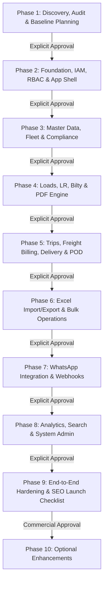

# Phased Implementation Roadmap & Verification Gates

**Platform:** MERN Fleet & Transport Management Platform  
**Execution Rule:** Strict Phased Execution with explicit gate approvals. Never implement future phases in advance.

---

## Roadmap Overview

---

## Detailed Phase Breakdown & Acceptance Gates

### Phase 1: Discovery, Repository Audit, Scope & Baseline Architecture (CURRENT)
- **Core Deliverables:**
  - Workspace inspection, git repository isolation, local runtime discovery.
  - SOW Traceability Matrix covering all 26 SOW sections and 20 launch checklist items (`docs/SOW_TRACEABILITY.md`).
  - Evidence-based technical audit of reference repository (`docs/REFERENCE_REPO_AUDIT.md`).
  - Complete architecture, error contract, auth, tenancy, sequencing, and storage design (`docs/ARCHITECTURE.md`).
  - Full MongoDB data model with schemas, indexes, and Mermaid ERD (`docs/DATA_MODEL.md`).
  - RBAC permission matrix for 8 roles across 22 modules (`docs/ROLE_PERMISSION_MATRIX.md`).
  - Business rules for freight formulas, GTA GST SAC 9965, and state machines (`docs/BUSINESS_RULES.md`).
  - Client open questions and architectural decisions log (`docs/DECISIONS_AND_OPEN_QUESTIONS.md`).
  - Client dependency and onboarding checklist (`docs/DEPENDENCY_CHECKLIST.md`).
  - Safe `.env.example`, `.gitignore`, minimal project foundation and Phase 1 verification tests.
- **Verification Gate:** Automated test verifying document existence, schema integrity, and baseline environment checks.
- **Hard Stop:** STOP and wait for user's explicit command: `APPROVE PHASE 1 — START PHASE 2`.

---

### Phase 2: Monorepo Foundation, IAM, RBAC, Audit & App Shell
- **Prerequisite:** Explicit Phase 1 approval.
- **Core Deliverables:**
  - Express server initialization with TypeScript strict mode, MongoDB connection, centralized error handling, and rate limiting.
  - User model, authentication routes (`/login`, `/logout`, `/refresh`, `/me`), bcrypt hashing, secure httpOnly cookies.
  - Server-side RBAC middleware (`requirePermission`), tenant scoping middleware (`enforceTenantScope`).
  - Append-only `AuditLog` service.
  - React 19 + Vite frontend shell, responsive navy/charcoal sidebar, user menu, toast system, and protected route wrappers.
- **Verification Gate:** Integration tests for login, invalid credentials rate-limiting, token refresh rotation, and 403 authorization checks.

---

### Phase 3: Core Master Data: Customers, Locations, Vehicles & Drivers
- **Prerequisite:** Explicit Phase 2 approval.
- **Core Deliverables:**
  - Customer party CRUD with multiple delivery addresses, GSTIN validation, payment terms.
  - Location master CRUD with type, coordinates, and contact details.
  - Vehicle registry with plate validation, ownership category, and status management.
  - Vehicle document compliance tracker (`RC`, `INSURANCE`, `PUC`, `FITNESS`) with private file upload and expiry warning windows (30/15/7 days).
  - Driver registry with DL number, licence category, KYC documents, and expiry tracking.
  - Master data Excel import preview & dry-run validation.
- **Verification Gate:** Automated tests for duplicate plate/DL rejection, document expiry alerts, and private file download permissions.

---

### Phase 4: Loads, Multi-Stop Route Data, LR, Bilty & PDF Engine
- **Prerequisite:** Explicit Phase 3 approval.
- **Core Deliverables:**
  - Load creation with consignor/consignee, material, weight, freight lines, and atomic sequential Load # allocation.
  - Multi-location ordered stops (`PICKUP` and `DELIVERY`) with stop sequence and quantity allocation.
  - LR number allocation (atomic sequential generator with manual entry collision protection) and 6-stage lifecycle state machine.
  - Bilty / Consignment note generation linked to LR, load, and payment terms.
  - Server-side PDF generation engine (using `pdfkit` / `puppeteer-core`) for LR, Bilty, Loading Slip, Gate Pass, and Delivery Challan with company logo, GST, and terms.
- **Verification Gate:** Race-condition concurrency tests for sequence numbering, PDF text extraction verification, and invalid state transition rejection.

---

### Phase 5: Trip Assignment, Freight Billing, Delivery & Proof of Delivery (POD)
- **Prerequisite:** Explicit Phase 4 approval.
- **Core Deliverables:**
  - Trip dispatch engine with pre-requisite compliance validation (blocks vehicle/driver if document expired or already assigned to active trip).
  - Financial calculation engine (server-side computation of base freight, loading, unloading, detention, tolls, 5% GTA GST SAC 9965, advances, deductions, and balance).
  - Multi-stop partial delivery recording with quantity reconciliation (preventing over-delivery).
  - Proof of Delivery (POD) image/PDF upload, attachment to stop/LR, and supervisor signoff.
  - Trip closure validation (requires all stops completed and POD attached).
- **Verification Gate:** Financial rounding and calculation tests, trip conflict rejection tests, stop quantity reconciliation tests.

---

### Phase 6: Excel / CSV Operations: Complete Imports, Exports & Bulk Workflows [COMPLETED]
- **Prerequisite:** Explicit Phase 5 approval.
- **Status:** **COMPLETED & VERIFIED** (7/7 Phase 6 automated integration tests passing, 69/69 cumulative suite passing).
- **Core Deliverables:**
  - Robust streaming `.xlsx` and `.csv` exports for all filtered list views and reports with CSV formula injection sanitization.
  - Two-stage import engine (Upload $\rightarrow$ Dry-Run Validate $\rightarrow$ Preview Error Table $\rightarrow$ Confirm Import) for master data and loads.
  - Downloadable versioned Excel templates with sample data.
  - Async export jobs for large datasets with download expiry.
  - Export permission enforcement and download audit logging.
- **Verification Gate:** Formula injection test (`=cmd|' /C calc'!A0`), malformed workbook recovery test, duplicate row rejection test. All 7 tests passing.

---

### Phase 7: WhatsApp Messaging Engine, Message Queue & Webhooks [COMPLETED]
- **Prerequisite:** Explicit Phase 6 approval.
- **Status:** **COMPLETED & VERIFIED** (8/8 Phase 7 automated integration tests passing, 77/77 cumulative suite passing).
- **Core Deliverables:**
  - WhatsApp provider abstraction interface (`IWhatsAppProvider`) and factory (`WhatsAppAdapterFactory`).
  - `MockWhatsAppAdapter` with detailed audit logging for local development and test automation.
  - Production adapters (`InteraktWhatsAppAdapter` for Indian BSP and `TwilioWhatsAppAdapter` for international/programmable messaging).
  - Business template registry with Indian mobile phone E.164 normalization (`+91`) and variable substitution for `LOAD_CREATED`, `VEHICLE_DISPATCHED`, `IN_TRANSIT`, `DELIVERY_COMPLETED`, and `LR_BILTY_SHARE`.
  - Secure document PDF sharing with authenticated streaming URL and caption.
  - Secure inbound webhook handler with HMAC-SHA256 signature verification and replay defense.
  - Idempotent delivery status progression engine (`QUEUED` $\rightarrow$ `DISPATCHED` $\rightarrow$ `DELIVERED` $\rightarrow$ `READ`) preventing status degradation from out-of-order webhooks.
  - Retry mechanism with exponential backoff calculation and delivery failure tracking.
  - Multi-tenant tenant scoping and isolated message logs.
  - Admin settings for credentials with masked retrieval (`toMaskedJSON()`).
  - Full frontend Communication Hub (`apps/web/src/pages/WhatsAppPage.tsx`) with dispatch composer, live mobile chat preview bubble, delivery history table, and provider configuration modal.
- **Verification Gate:** 8/8 Phase 7 integration tests passing (`phase7-whatsapp.test.js`), full regression suite (Phases 1–7: 77/77 tests passing).

---

### Phase 8: Operations Dashboard, Reports, Global Search & System Admin [COMPLETED]
- **Prerequisite:** Explicit Phase 7 approval.
- **Status:** **COMPLETED & VERIFIED** (9/9 Phase 8 automated integration tests passing, 86/86 cumulative suite passing).
- **Core Deliverables:**
  - Real-time MongoDB aggregation pipeline engine for KPI metric cards (Total & Today's Loads, Active Trips, Fleet Vehicle & Driver Availability, Freight Billed & Balance Outstanding, Regulatory Compliance Expiries, Pending PODs).
  - 7-day continuous velocity timeline and actionable operational alerts feed with direct routing deep-links.
  - Multi-criteria filterable reports engine for Loads, Trips & Route Expenses, Freight Ledger (SAC 9965 GTA 5% GST), and Compliance Audits.
  - Formula-injection-sanitized streaming Excel (.xlsx) and CSV exports with auto-column width and frozen headers.
  - ReDoS-safe regex indexer global search engine querying across Loads, LRs, Bilties, Trips, Vehicles, Drivers, Customers, and Locations scoped strictly by `companyId`.
  - Organization settings management for legal/trade name, GSTIN, PAN, registered office address, currency/timezone defaults, and document numbering prefixes.
  - Complete frontend interface: Live Operations Dashboard (`DashboardPage.tsx`), Multi-tab Operational Reports Hub (`ReportsPage.tsx`), Command Palette Modal (`GlobalSearchModal.tsx`) with `Ctrl+K` shortcut, and Organization Settings (`AdminSettingsPage.tsx`).
- **Verification Gate:** 9/9 Phase 8 integration tests passing (`phase8-dashboard-reports.test.js`), full regression suite (Phases 1–8: 86/86 tests passing), clean production frontend build (`npm run build:web`).

---

### Phase 9: End-to-End Hardening, 20-Point Launch Checklist, Performance & Deployment [COMPLETED]
- **Prerequisite:** Explicit Phase 8 approval.
- **Status:** **COMPLETED & VERIFIED** (8/8 Phase 9 automated tests passing, 94/94 cumulative master test suite passing across all Phases 1–9, 0 failures; Frontend production bundle built cleanly).
- **Core Deliverables:**
  - Full end-to-end operational lifecycle verification (Customer & Location onboarding $\rightarrow$ Vehicle & Driver assignment $\rightarrow$ Multi-stop Load creation $\rightarrow$ LR & Bilty document generation $\rightarrow$ Trip dispatch $\rightarrow$ Stop deliveries $\rightarrow$ Proof of Delivery verification $\rightarrow$ Trip closure and asset release back to `AVAILABLE`).
  - Full implementation of all 20 Launch Checklist items:
    1. SSR / Rendering Strategy evaluation: `docs/RENDERING_STRATEGY.md`
    2. `robots.txt`: Public allow `/`, `/login`, `/privacy`, `/terms`, `/contact`; private disallow `/app/`, `/api/`, `/documents/`
    3. `sitemap.xml`: Whitelist-only XML sitemap without customer record leaks
    4. Unique title tags on all public and internal authenticated views
    5. High-relevance meta descriptions in `index.html`
    6. Strict single `<h1>` hierarchy per view
    7. Canonical tags (`https://transport.technofay.com/`)
    8. Open Graph & Twitter Cards (`og-image.svg`)
    9. Custom branded 404 Not Found Page (`NotFoundPage.tsx`)
    10. Loop-free 301 permanent redirects (`/dashboard` $\rightarrow$ `/app/dashboard`, `/login.html` $\rightarrow$ `/login`)
    11. Meaningful `alt` attributes on all images, icons, and status badges
    12. Modern vector & optimized assets (`favicon.svg`, `og-image.svg`)
    13. Native `loading="lazy"` on media assets
    14. Schema.org JSON-LD `LogisticsService` structured data
    15. Accessible breadcrumb navigation (`Breadcrumbs.tsx`)
    16. 100% valid internal hyperlinks with zero dead routing links
    17. Privacy-conscious operational analytics wrapper (`analytics.ts`) redacting PII and freight amounts
    18. Google Search Console setup & DNS verification runbook (`docs/SEARCH_CONSOLE_SETUP.md`)
    19. Comprehensive Privacy Policy (`PrivacyPage.tsx`) and Terms (`TermsPage.tsx`)
    20. Operational Contact Form backed by `POST /api/v1/contact`, honeypot spam protection, and MongoDB persistence (`ContactSubmission.js`, `contact.controller.js`, `ContactPage.tsx`).
  - Production DevOps & Deployment Runbooks:
    - Multi-stage production `Dockerfile` with non-root security user.
    - Multi-container `docker-compose.yml` with MongoDB 7 & Redis 7 health checks.
    - PM2 cluster manager `ecosystem.config.js`.
    - Automated MongoDB maintenance & recovery CLI (`scripts/db-backup-restore.js`) verified against 22 active collections.
    - Complete Operator Handover & Production Runbook (`docs/DEPLOYMENT_GUIDE.md`).
    - Automated Launch Checklist Verification Matrix (`docs/LAUNCH_CHECKLIST_VERIFICATION.md`).
- **Verification Gate:**
  - 8/8 automated tests passing in `apps/api/tests/phase9-e2e-hardening.test.js`.
  - 94/94 automated tests passing across master regression runner `scripts/run-all-tests.js` (Phases 1 through 9).
  - 100% clean production bundle build (`npm run build:web`).
  - Database schema & index verification passing across 22 collections.

---

### Phase 10: Optional Client-Approved Enhancements [COMPLETED]
- **Prerequisite:** Explicit commercial authorization (granted via user selection).
- **Status:** **COMPLETED & VERIFIED** (8/8 Phase 10 automated tests passing, 102/102 cumulative master test suite passing across all Phases 1–10, 0 failures; Frontend production bundle built cleanly; 23 MongoDB collections verified).
- **Core Deliverables:**
  - **Enhancement 1: Customer Self-Service Tracking Portal**:
    - Unauthenticated, rate-limited public tracking endpoints at `GET /api/v1/public/track/:identifier` and `GET /api/v1/public/track?q=...`.
    - Multi-key consignment resolution supporting LR Number (`LR-YYYY-XXXX`), Bilty Number (`BL-YYYY-XXXX`), or Load Number (`LD-YYYY-XXXX`).
    - Progressive 5-stage consignment milestone state machine (`BOOKED` $\rightarrow$ `DISPATCHED` $\rightarrow$ `IN_TRANSIT` $\rightarrow$ `OUT_FOR_DELIVERY` $\rightarrow$ `DELIVERED`).
    - Multi-stop offload progression with timestamps, locations, and cargo statuses.
    - Verified Proof of Delivery (POD) card with high-resolution preview link for delivered consignments.
    - Strict PII redaction masking vehicle registration (`MH31••••`), driver phone numbers, driver licenses, and omitting all commercial freight rates / charges.
    - SEO & Discovery integration with public route `/track` added to `robots.txt` and `sitemap.xml`.
  - **Enhancement 2: Interactive Route & Hub Map Visualization**:
    - Zero-dependency SVG/Canvas interactive route visualizer (`RouteMap.tsx`) with auto-bounding box coordinate scaling, responsive viewBox, and animated transit pulse.
    - Canonical Indian logistics coordinate database (`geoCoordinates.js`) covering 36+ major industrial corridors (Delhi, Mumbai, Nagpur, Bengaluru, Chennai, Kolkata, Ahmedabad, Hyderabad, Pune, Surat, Jaipur, Indore, etc.) with fuzzy city normalization and central hub fallback.
    - Operator trip route mapping endpoint at `GET /api/v1/trips/:id/route-map` with tenant scoping, waypoint sequence extraction, and route segment metadata.
  - **Enhancement 3: Fleet Maintenance & Servicing Subsystem**:
    - Data model `VehicleMaintenance.js` with compound unique index `{ companyId, maintenanceNumber }`, atomic numbering (`MNT-YYYY-XXXX`), and integer paise cost precision.
    - Service types: `PREVENTATIVE`, `BREAKDOWN`, `ACCIDENTAL`, `STATUTORY_FITNESS`, `TIRE_ROTATION`, `ENGINE_OVERHAUL`.
    - Priority classification: `LOW`, `MEDIUM`, `HIGH`, `CRITICAL`.
    - Automated vehicle status lifecycle state machine:
      - `SCHEDULED` $\rightarrow$ vehicle remains in current operational state.
      - `IN_PROGRESS` $\rightarrow$ automatically transitions vehicle to `UNDER_MAINTENANCE` (preventing double booking or dispatch).
      - `COMPLETED` $\rightarrow$ automatically restores vehicle to `AVAILABLE` status for new dispatch.
      - `CANCELLED` $\rightarrow$ releases maintenance reservation.
    - Maintenance KPI metrics endpoint `GET /api/v1/maintenance/stats` calculating total scheduled, in-progress, completed, total cost in rupees, and high-priority alerts.
  - **Frontend UI & Experience**:
    - Dedicated public tracking portal (`PublicTrackingPage.tsx`) accessible at `/track` and `/track/:identifier`.
    - Comprehensive Fleet Maintenance dashboard (`MaintenancePage.tsx`) mounted at `/app/maintenance` with KPI metrics, filter tabs, "Schedule Service" modal, and "Certify Completion" modal.
    - Navigation integration in `Sidebar.tsx` under Fleet & Assets.
    - Quick-tracking link in `LoginPage.tsx` footer.
- **Verification Gate:**
  - 8/8 automated tests passing in `apps/api/tests/phase10-enhancements.test.js`.
  - 102/102 automated tests passing across master regression runner `scripts/run-all-tests.js` (Phases 1 through 10).
  - 100% clean production bundle build (`npm run build:web`).
  - Database schema & index verification passing across 23 collections (including `vehiclemaintenances` with 6 indexes).

