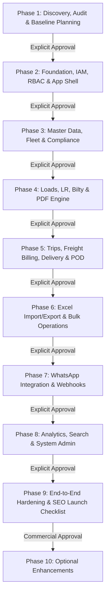

# Phased Implementation Roadmap & Verification Gates

**Platform:** MERN Fleet & Transport Management Platform  
**Execution Rule:** Strict Phased Execution with explicit gate approvals. Never implement future phases in advance.

---

## Roadmap Overview

---

## Detailed Phase Breakdown & Acceptance Gates

### Phase 1: Discovery, Repository Audit, Scope & Baseline Architecture (CURRENT)
- **Core Deliverables:**
  - Workspace inspection, git repository isolation, local runtime discovery.
  - SOW Traceability Matrix covering all 26 SOW sections and 20 launch checklist items (`docs/SOW_TRACEABILITY.md`).
  - Evidence-based technical audit of reference repository (`docs/REFERENCE_REPO_AUDIT.md`).
  - Complete architecture, error contract, auth, tenancy, sequencing, and storage design (`docs/ARCHITECTURE.md`).
  - Full MongoDB data model with schemas, indexes, and Mermaid ERD (`docs/DATA_MODEL.md`).
  - RBAC permission matrix for 8 roles across 22 modules (`docs/ROLE_PERMISSION_MATRIX.md`).
  - Business rules for freight formulas, GTA GST SAC 9965, and state machines (`docs/BUSINESS_RULES.md`).
  - Client open questions and architectural decisions log (`docs/DECISIONS_AND_OPEN_QUESTIONS.md`).
  - Client dependency and onboarding checklist (`docs/DEPENDENCY_CHECKLIST.md`).
  - Safe `.env.example`, `.gitignore`, minimal project foundation and Phase 1 verification tests.
- **Verification Gate:** Automated test verifying document existence, schema integrity, and baseline environment checks.
- **Hard Stop:** STOP and wait for user's explicit command: `APPROVE PHASE 1 — START PHASE 2`.

---

### Phase 2: Monorepo Foundation, IAM, RBAC, Audit & App Shell
- **Prerequisite:** Explicit Phase 1 approval.
- **Core Deliverables:**
  - Express server initialization with TypeScript strict mode, MongoDB connection, centralized error handling, and rate limiting.
  - User model, authentication routes (`/login`, `/logout`, `/refresh`, `/me`), bcrypt hashing, secure httpOnly cookies.
  - Server-side RBAC middleware (`requirePermission`), tenant scoping middleware (`enforceTenantScope`).
  - Append-only `AuditLog` service.
  - React 19 + Vite frontend shell, responsive navy/charcoal sidebar, user menu, toast system, and protected route wrappers.
- **Verification Gate:** Integration tests for login, invalid credentials rate-limiting, token refresh rotation, and 403 authorization checks.

---

### Phase 3: Core Master Data: Customers, Locations, Vehicles & Drivers
- **Prerequisite:** Explicit Phase 2 approval.
- **Core Deliverables:**
  - Customer party CRUD with multiple delivery addresses, GSTIN validation, payment terms.
  - Location master CRUD with type, coordinates, and contact details.
  - Vehicle registry with plate validation, ownership category, and status management.
  - Vehicle document compliance tracker (`RC`, `INSURANCE`, `PUC`, `FITNESS`) with private file upload and expiry warning windows (30/15/7 days).
  - Driver registry with DL number, licence category, KYC documents, and expiry tracking.
  - Master data Excel import preview & dry-run validation.
- **Verification Gate:** Automated tests for duplicate plate/DL rejection, document expiry alerts, and private file download permissions.

---

### Phase 4: Loads, Multi-Stop Route Data, LR, Bilty & PDF Engine
- **Prerequisite:** Explicit Phase 3 approval.
- **Core Deliverables:**
  - Load creation with consignor/consignee, material, weight, freight lines, and atomic sequential Load # allocation.
  - Multi-location ordered stops (`PICKUP` and `DELIVERY`) with stop sequence and quantity allocation.
  - LR number allocation (atomic sequential generator with manual entry collision protection) and 6-stage lifecycle state machine.
  - Bilty / Consignment note generation linked to LR, load, and payment terms.
  - Server-side PDF generation engine (using `pdfkit` / `puppeteer-core`) for LR, Bilty, Loading Slip, Gate Pass, and Delivery Challan with company logo, GST, and terms.
- **Verification Gate:** Race-condition concurrency tests for sequence numbering, PDF text extraction verification, and invalid state transition rejection.

---

### Phase 5: Trip Assignment, Freight Billing, Delivery & Proof of Delivery (POD)
- **Prerequisite:** Explicit Phase 4 approval.
- **Core Deliverables:**
  - Trip dispatch engine with pre-requisite compliance validation (blocks vehicle/driver if document expired or already assigned to active trip).
  - Financial calculation engine (server-side computation of base freight, loading, unloading, detention, tolls, 5% GTA GST SAC 9965, advances, deductions, and balance).
  - Multi-stop partial delivery recording with quantity reconciliation (preventing over-delivery).
  - Proof of Delivery (POD) image/PDF upload, attachment to stop/LR, and supervisor signoff.
  - Trip closure validation (requires all stops completed and POD attached).
- **Verification Gate:** Financial rounding and calculation tests, trip conflict rejection tests, stop quantity reconciliation tests.

---

### Phase 6: Excel / CSV Operations: Complete Imports, Exports & Bulk Workflows [COMPLETED]
- **Prerequisite:** Explicit Phase 5 approval.
- **Status:** **COMPLETED & VERIFIED** (7/7 Phase 6 automated integration tests passing, 69/69 cumulative suite passing).
- **Core Deliverables:**
  - Robust streaming `.xlsx` and `.csv` exports for all filtered list views and reports with CSV formula injection sanitization.
  - Two-stage import engine (Upload $\rightarrow$ Dry-Run Validate $\rightarrow$ Preview Error Table $\rightarrow$ Confirm Import) for master data and loads.
  - Downloadable versioned Excel templates with sample data.
  - Async export jobs for large datasets with download expiry.
  - Export permission enforcement and download audit logging.
- **Verification Gate:** Formula injection test (`=cmd|' /C calc'!A0`), malformed workbook recovery test, duplicate row rejection test. All 7 tests passing.

---

### Phase 7: WhatsApp Messaging Engine, Message Queue & Webhooks
- **Prerequisite:** Explicit Phase 6 approval.
- **Core Deliverables:**
  - WhatsApp provider abstraction interface (`IWhatsAppProvider`).
  - `MockWhatsAppAdapter` with audit logging for local development.
  - Production adapter (`Interakt` / `Twilio`) activated via environment credentials.
  - Outbound messaging for Load Created, Vehicle Dispatched, Delivery Complete, and LR/Bilty PDF sharing.
  - Inbound webhook endpoint with HMAC signature verification and idempotent delivery status updates.
  - Masked credential configuration UI in Admin Settings.
- **Verification Gate:** Webhook signature verification tests, mock send logging tests, retry backoff tests.

---

### Phase 8: Operations Dashboard, Reports, Global Search & System Admin
- **Prerequisite:** Explicit Phase 7 approval.
- **Core Deliverables:**
  - Live MongoDB aggregation dashboard KPI cards (Loads, Active Trips, Fleet Availability, Pending PODs, Freight Outstanding).
  - Comprehensive operational reports with multi-criteria filters (date, vehicle, driver, customer, status).
  - Debounced global search across LR, Bilty, Load, Trip, Vehicle, Driver, Customer, and Location.
  - System audit trail explorer with filterable event history.
  - Admin panel for company profile, numbering prefixes, document templates, and user roles.
- **Verification Gate:** Metric accuracy tests against test database records, global search latency and indexing tests.

---

### Phase 9: End-to-End Hardening, 20-Point Launch Checklist, Performance & Deployment
- **Prerequisite:** Explicit Phase 8 approval.
- **Core Deliverables:**
  - Verification of all 20 launch checklist items (robots.txt, sitemap.xml, titles, H1s, canonicals, OG tags, 404, redirects, alt text, WebP, schema, breadcrumbs, analytics, contact form).
  - Security audit: OWASP Top 10 hardening, rate-limiting, secret scans, dependency audit (`npm audit`).
  - Performance audit: database compound index validation, query explain plans, bundle size optimization.
  - Production deployment setup: Dockerfile, docker-compose, PM2 config, MongoDB backup and restore rehearsal script.
  - Operator onboarding documentation and administrative runbooks.
- **Verification Gate:** Full end-to-end automated test suite execution (login $\rightarrow$ load $\rightarrow$ LR $\rightarrow$ trip $\rightarrow$ delivery $\rightarrow$ POD $\rightarrow$ statement $\rightarrow$ export).

---

### Phase 10: Optional Client-Approved Enhancements
- **Prerequisite:** Explicit commercial authorization.
- **Scope Options:** Live GPS telematics API integration, customer self-service tracking portal, automated customer SMS/email alerts, payment gateway integration.
