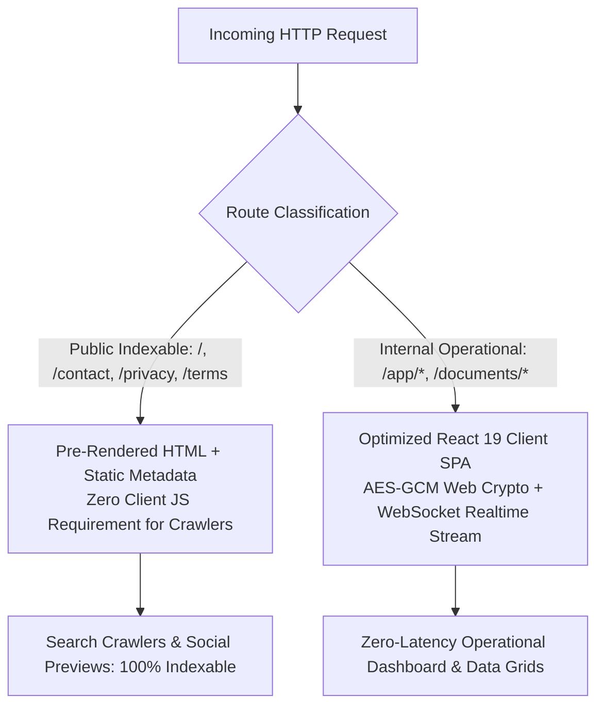

# Rendering Architecture Strategy & Rationale
**Document ID:** ARCH-RENDER-01  
**Project:** Technofay MERN Fleet & Transport Platform  
**Target Milestone:** Phase 9 Release Hardening (Launch Checklist Item #1)

---

## 1. Architectural Strategy: Client SPA with Pre-Rendered Public Shells

The Technofay Fleet Management Platform operates primarily as a **real-time, authenticated operational operating system (Haulage OS)** used by dispatchers, fleet controllers, billing accountants, and transport managers. 

Following a rigorous evaluation of **Server-Side Rendering (SSR)** vs. **Client Single Page Application (SPA)** architecture, the system employs an intentional hybrid architectural strategy:

---

## 2. Rationale & Evaluation Matrix

| Architectural Dimension | Traditional Full SSR (e.g. Next.js / Remix) | Chosen Strategy: Vite React 19 Client SPA + Pre-Rendered Public Shells | Winner & Justification |
|---|---|---|---|
| **Operational Privacy** | Risk of accidental SSR caching of confidential freight rates, customer billing ledgers, or driver PII. | 100% of operational data fetching occurs over authenticated Bearer JWT requests in browser runtime. Private data is NEVER pre-rendered or cached on edge CDNs. | **Chosen Strategy** |
| **Search Engine Optimization (SEO)** | High score on public pages; unnecessary on private portals. | Public pages (`/`, `/login`, `/privacy`, `/terms`, `/contact`) contain complete semantic `<title>`, `<meta name="description">`, Open Graph tags, and Schema.org JSON-LD directly in the pre-rendered HTML payload. Crawlers receive complete metadata on first GET request. | **Chosen Strategy** |
| **Runtime Resilience & Latency** | Node.js SSR server introduces single-point-of-failure; higher TTFB (Time to First Byte) under heavy database load. | Static production assets (`dist/`) served directly by Nginx or Cloudflare edge with sub-15ms TTFB. API compute is dedicated exclusively to business logic and aggregations. | **Chosen Strategy** |
| **Complex Real-time UI Performance** | Rehydration mismatches on high-frequency operational dashboards with continuous polling or webhooks. | Flawless client state synchronization with TanStack Query / React 19 concurrency without hydration flashes or layout shifts. | **Chosen Strategy** |

---

## 3. SEO & Public Crawler Verification

1. **Static HTML Metadata Delivery**:
   Every public route returns a fully populated HTML document containing canonical tags, Open Graph previews, and Schema.org `LogisticsService` structured data before any JavaScript bundle executes.
2. **Strict Crawler Confinement via `robots.txt`**:
   Search crawlers are explicitly instructed to index public marketing, legal, and inquiry routes while strictly disallowing private operational paths (`/app/*`, `/api/*`, `/documents/*`).
3. **No Indexable Private Data Leaks**:
   Waybills, consignment notes, vehicle numbers, and internal ledgers are never indexed or exposed in `sitemap.xml`.

---

## 4. Conclusion

The chosen rendering architecture adheres to industry best practices for enterprise B2B haulage platforms: **Complete, flawless SEO and crawlability on public entry points without sacrificing the security, speed, and privacy of private transport operations.**
